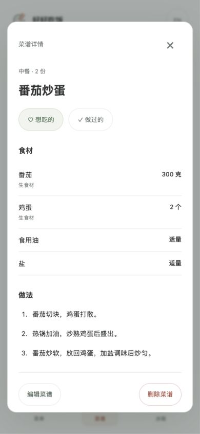

# Eat Well · 好好吃饭

A small cooking app for saving recipes, planning meals, and keeping track of what is in the fridge. Built for mobile browsers, with Chinese and English interfaces.

保存自己的菜谱，安排每天吃什么，记录冰箱里的食材。

## Screenshots

| Meal planning | Recipe details | Pantry entry |
| --- | --- | --- |
|  |  |  |

Screenshots from the local app. The recipe is a sample; the pantry form shows an unsaved example.

## Features

- **Recipes** — ingredients, quantities, servings, cooking steps and optional photos. Keep separate lists of dishes you want to cook and dishes you have made.
- **Meal planning** — choose a recipe for today's or tomorrow's lunch and dinner. Replace dishes, adjust planned servings, or remove a meal.
- **Pantry** — track quantities, storage locations and optional dates. Search common ingredients using Chinese or English names, including aliases such as 番茄 / 西红柿 / tomato.
- **Local storage** — recipes, photos, menus and pantry entries stay in the browser and survive a refresh.

## Run locally

Requires Python 3 and Node.js 20+. No dependency installation is needed.

```sh
git clone https://github.com/xuan-2048/eat-well.git
cd eat-well
npm start
```

Open [localhost:8011](http://localhost:8011). Press `Ctrl+C` in the terminal to stop the server.

If the port is occupied:

```sh
python3 -m http.server 8012 --bind 127.0.0.1
```

## How it works

The app uses HTML, CSS and JavaScript ES modules. Python serves the static files locally. There is no application server or account system.

Recipes store ingredient amounts and units separately, along with the number of servings. Meal plans reference a recipe by ID and keep their own planned portions. Pantry entries are separate batches, so a bag and a weighed portion are not combined automatically.

Photos are processed in the browser and saved as compressed JPEGs. Data is stored in `localStorage`; clearing site data removes the records. Different browsers, devices and ports have separate storage. Export and cloud sync are not available yet.

```text
src/
  app.js             UI and interactions
  recipes.js         Recipe validation, filtering and storage
  plans.js           Dates, meal assignments and planned servings
  pantry.js          Inventory, date reminders and storage
  foods.js           Common ingredient names and aliases
  *copy.js           Chinese and English interface text
  styles.css         Layout and typography
tests/               Model, persistence and language tests
```

## Checks

```sh
npm run check
npm test
```

Tests cover validation, persistence, filtering, ingredient aliases, date boundaries, meal replacement, missing recipes and storage errors. The interface is also checked at 320px and 390px phone widths.

## Next

- Plan more than one dish per meal and scale ingredients by servings.
- Check planned meals against pantry stock and build a shopping list.
- Add a weekly menu and cooking history.
- Export and restore local data.
- Estimate nutrition per recipe and serving.
- Add offline support and installation to the home screen.

Each meal currently holds one dish. Planned portions are separate from actual food intake. Entered dates are reminders, not a determination of food safety.

## Design reference

The menu layout was inspired by [Civa](https://xhslink.cn/o/4xtGwV55nr9). The logo, plate placeholders and page styling are drawn for this project.
