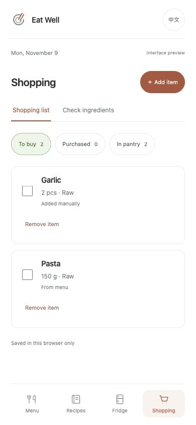

# Eat Well · 好好吃饭

A cooking app for the question that comes up every day: what should I make, and what do I need to buy?

Save your own recipes, put a few dishes on today's or tomorrow's menu, and check the ingredients against your fridge before making a shopping list. The interface supports English and Chinese and is designed for phone browsers.

保存菜谱、安排一餐里的几道菜，用冰箱里已有的食材核对缺料，再整理购物清单。

## What you can do

### Recipes and meal plans

Recipes have a serving count, measured ingredients, preparation states, cooking steps and an optional photo. Cuisine filters and name or ingredient search help find a saved dish. “Want to cook” and “Cooked” are independent labels.

Lunch and dinner can each hold several dishes. Add, replace or remove one dish without changing the rest of the meal. Every dish has its own planned servings and an ingredient preview. Changing a two-serving recipe to three planned servings multiplies measured amounts by 1.5; ingredients marked “to taste” stay unmeasured. The saved recipe stays unchanged. The same scaling control is available in recipe details.

### Fridge and ingredient checks

Keep separate stock entries with a quantity, unit, raw/cooked state, storage location and optional expiry date. Search works with common Chinese and English aliases, including 番茄, 西红柿 and tomato. Custom ingredients are supported too.

Choose **Today**, **Tomorrow** or **Both days** under **Shopping → Check ingredients**. Requirements are combined across the selected dishes, then stock is allocated once across those requirements. The result shows the amount needed, the stock counted and the remaining gap.

| Situation | How it is handled |
| --- | --- |
| g and kg, or ml and L | Converted to a shared unit before comparison |
| Pieces, packs, bottles, teaspoons or tablespoons | Compared only with the same unit |
| A recipe needs pieces but stock is recorded by weight | Flagged for manual confirmation |
| Recipe specifies raw or cooked, but stock differs or is unspecified | Flagged for manual confirmation |
| Stock has a date before the planned meal | Excluded from that meal's calculation |
| Stock has no date | Can count if its unit and preparation match |
| Recipe says “to taste” | Kept unknown and shown for review |

For example, if two dishes need 450 g and 200 g of tomatoes, the total is 650 g. With 0.2 kg of matching tomatoes in the fridge, the shopping gap is 450 g. A pack of tomatoes is not assigned a guessed weight.

“Counted stock” is the amount allocated to the selected meals, capped at their need. It may be smaller than the total quantity in the fridge. Entered dates are organization reminders; the app does not assess whether food is safe to eat.

### Shopping and putting groceries away

**Update shopping list** creates items for measured shortages. Repeating it refreshes the unpurchased menu items rather than appending duplicates. Compatible ingredients from several dishes become one requirement. Manually added and purchased items stay on the list; their known quantities count toward the gap when the list is updated. Items needing review are left out until you confirm a purchase amount.

You can also add groceries by hand, including items with an undecided quantity. Compatible manual entries merge. Different units or preparation states remain separate.

The list has **To buy**, **Purchased** and **In pantry** groups. Checking a purchase moves it to Purchased. **Add to pantry** then asks for the actual quantity, preparation, storage and date. If the list called for 3 eggs but you bought 6, the fridge gets 6. The original shopping requirement is retained separately. Retrying a partly saved receipt does not create a second stock batch.

Planning meals and buying groceries do not automatically consume stock or record food intake.

## Screenshots

Captured from the English interface with sample recipes and stock in a separate local demo. Each image opens at its full size.

### Several dishes in one meal


Each dish keeps its own servings and edit control.

### Ingredient scaling


A two-serving recipe viewed at three servings. Unmeasured oil and salt stay “to taste.”

### Fridge stock


Purchased quantities become separate batches; existing stock keeps its own unit and storage details.

### Shopping list



The sample contains a menu-generated pasta item and a manually confirmed garlic item. See the [full ingredient check](docs/images/shortages.jpg) for covered, missing and uncertain quantities.

## Try it locally

Requires Python 3 and Node.js 20 or newer. There are no npm dependencies to install and no API keys to configure.

```sh
git clone https://github.com/xuan-2048/eat-well.git
cd eat-well
npm start
```

Open [localhost:8011](http://localhost:8011). Stop the server with `Ctrl+C`.

If that port is already in use:

```sh
python3 -m http.server 8012 --bind 127.0.0.1
```

Open `http://localhost:8012` instead. A different port uses a separate browser data store.

To walk through the app:

1. Open **Recipes** and use **Add sample recipe**, or save your own recipe with ingredient quantities.
2. Open **Menu**, add a lunch dish and choose its servings. Add a second dish to the same lunch.
3. Add the stock you already have under **Fridge**, including preparation states where known.
4. Use **Check ingredients** and choose the days to compare. Review any uncertain units or amounts.
5. Update the shopping list, mark an item purchased and confirm its actual quantity with **Add to pantry**.
6. Refresh the page to see the saved recipes, menu, stock and shopping items.

The language button switches interface text and recognized food names. User-written recipe names and instructions remain as entered.

## Code and data

The app uses HTML, CSS and JavaScript ES modules. Python only serves the static files. There is no account system, backend or external recipe service.

```text
src/
  app.js             Page rendering, forms and interactions
  recipes.js         Recipe validation, filtering and storage
  plans.js           Dated dish assignments, migration and serving calculations
  pantry.js          Stock batches, date filters and persistence
  foods.js           Common food names and bilingual aliases
  shortages.js       Unit normalization and stock allocation
  shopping.js        List generation, manual merging and receipt handling
  *copy.js           English and Chinese interface text
  styles.css         Shared typography and responsive layout
tests/               Model, persistence and translation tests
docs/images/         Screenshots from the running app
```

Recipes, photos, meal plans, pantry batches and shopping items are stored in `localStorage`. Photos are resized and compressed to JPEG in the browser. Data stays in the current browser profile and origin; it does not sync between devices. Clearing site data removes it. Export and restore are still planned.

Each dish assignment references a recipe ID and stores its own date, meal and servings. Ingredient requirements use the recipe's current quantities. A missing recipe remains visible in the menu and raises a warning during the ingredient check.

Existing single-dish menus load into the multiple-dish format without changing their dates or servings. On the first save, the original version-1 menu payload is backed up before version 2 is written. Unreadable saved collections are reported rather than silently replaced. Receipt handling uses a stable stock ID so an interrupted save can be retried without duplicate groceries.

## Checks

```sh
npm run check
npm test
```

The tests cover recipe and stock validation, language coverage, date boundaries, menu migration, independent dish edits, serving calculations, alias and unit matching, stock allocation across dates, list regeneration, receipt retries and storage failures. Browser checks cover the save/reload workflow and layouts at 320 px and 390 px widths.

## Still to come

- A weekly calendar and copying a meal to another date.
- Cooking records with actual portions, notes and photos.
- JSON export and restore.
- Nutrition estimates per recipe, followed by daily totals from actual intake.
- Offline support and installation to the home screen.

At present, the “Cooked” label is not a dated cooking record, and planned servings are not actual dietary intake.

## Design reference

The menu layout was inspired by [Civa](https://xhslink.cn/o/4xtGwV55nr9). The logo, plate placeholders and page styling are drawn for this project.
