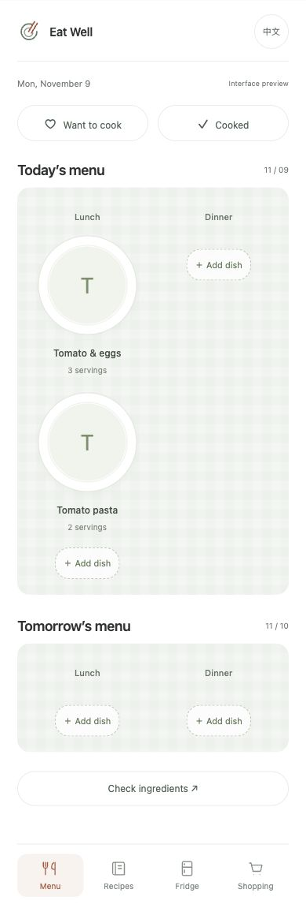
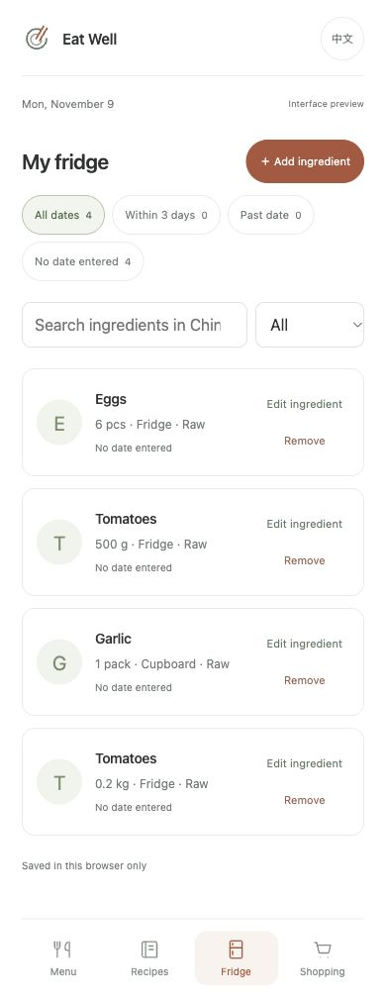
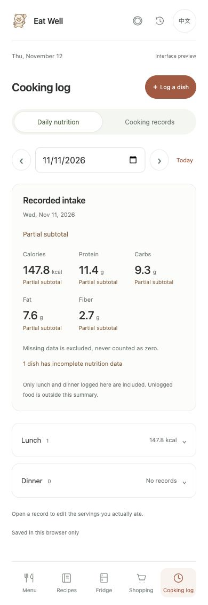

# Eat Well · 好好吃饭

A cooking planner for phone browsers, with React/TypeScript nutrition and cooking-history views and a Node.js API. Other screens use JavaScript modules while they are migrated. Save recipes, plan meals, check your fridge and turn missing ingredients into a shopping list.

一个支持中英文的做饭小工具：保存菜谱、安排菜单、管理冰箱库存、整理购物清单，记录实际做了什么和吃了多少。

## Features

- **Recipes:** measured ingredients, cooking steps, optional total cooking time, cuisine filters, search and six editable sample recipes with source links. Optional photos support dragging and zooming to choose a crop.
- **What to cook:** pick a saved dish by cuisine and available time, with stock matching and recent cooking records influencing the order. See the reason, try another dish, add it to lunch or dinner, or append measured shortages to the shopping list.
- **Meal planning:** daily and weekly views, several dishes per meal, separate serving counts and copying a meal to another date. Swipe through dishes or expand the whole meal.
- **Fridge:** stock batches with quantities, units, preparation states, storage locations and optional dates. Common Chinese and English ingredient names share the same identity.
- **Shopping:** check planned dishes against stock, combine shortages and confirm the actual amount bought before adding groceries to the fridge.
- **Cooking log:** daily nutrition totals and expandable meal details use the servings actually eaten. New records preserve their nutrition estimate; missing quantities remain visible. Keep servings made separate from servings eaten. Review stock use before deducting it; deductions can be undone.
- **Nutrition:** estimate calories, protein, carbs, fat and fiber per serving or for the whole recipe. Check ingredient contributions and confirm missing edible weights. Uses a local USDA reference dataset; no API key is needed.
- **Appearance:** Chinese/English interface, four ceramic plate styles, and matching SVG sketches for dishes and fridge ingredients.
- **Backups:** export JSON, preview an import and recover the data from before the last replacement. Photos can be cleared without removing recipes or menus.

## Screenshots

English interface with sample data.

### Weekly menu

Choose a day, arrange lunch and dinner, and check the ingredients needed for the week.

<a href="docs/images/menu.jpg"></a>

### Fridge

Each ingredient batch keeps its own quantity, unit and storage details.

<a href="docs/images/pantry.jpg"></a>

### Daily nutrition

Actual eaten portions, meal subtotals and visible gaps in ingredient data.

<a href="docs/images/daily-nutrition.jpg"></a>

## Run locally

Requires Node.js 22.18 or newer. No API keys are needed.

```sh
git clone https://github.com/xuan-2048/eat-well.git
cd eat-well
npm ci
npm start
```

Open [localhost:8011](http://localhost:8011). This starts the Vite frontend and the API on port 8020; `Ctrl+C` stops both. Keep using the same hostname and port to access your existing browser data.

To run the frontend and API separately, use `npm run dev:frontend` and `npm run dev:server` in two terminals. Optional server settings are listed in `.env.example`.

A different port has its own browser data. For a walkthrough of recipes, menus and stock use, see [the usage guide](docs/USAGE.md).

## Data and calculations

Data is saved in the current browser with `localStorage`. There is no account system or cloud sync. Clearing site data removes the saved collections and the local recovery copy, so download a JSON backup to keep a separate copy.

Ingredient checks convert g/kg and ml/L. They do not guess the weight of a piece or pack, convert volume to weight, or treat an unmeasured ingredient as zero. Incompatible units and preparation states are shown for review. Entered food dates are reminders, not food-safety assessments.

Planned servings do not count as actual intake. Cooking records keep a recipe snapshot and use the portions actually entered. The daily summary covers only logged lunch and dinner; an empty intake field is unknown, while zero means nothing was eaten. New records pin the per-serving nutrient values and their source version, so later recipe or reference-data changes do not rewrite those estimates. Stock changes only after confirmation.

Nutrition uses 42 reference foods from USDA FoodData Central’s April 2018 SR Legacy release. Only matched ingredients with a usable edible weight are included. Partial results are labelled as known subtotals; unweighed oil, unmatched ingredients and missing source values are not zero. You can inspect the reference food and its values per 100 g, or choose another reference and enter a weight. See [nutrition data and calculations](docs/NUTRITION.md) for the method and limitations.

The nutrition view sends ingredient quantities and reference choices to the local API. Photos, cooking notes and the rest of the browser data are not sent. The API calculates a result without saving the request; if it is unavailable, the view uses the same local calculation rules. See [code and storage details](docs/ARCHITECTURE.md) and [API endpoints](docs/API.md).

## Checks

```sh
npm run check
npm test
npm run build
```

Tests cover recommendation filtering, stock-based ranking, duplicate-safe menu and grocery actions, recipe validation, meal planning, quantity scaling, ingredient matching, shopping receipts, cooking records, stock deduction and undo, backup/restore, plate preferences and illustration matching. Browser checks include English/Chinese views and phone-width layouts.

## Next

- Move the remaining page rendering and forms into React/TypeScript components, then add AI features through the backend.
- Extend dish suggestions with dietary preferences and optional weather information.
- Offline support and home-screen installation.

Details: [roadmap](docs/ROADMAP.md), [sample recipe sources](docs/RECIPE_CATALOG.md), [design notes](docs/DESIGN.md).

The early menu layout was inspired by [Civa](https://xhslink.cn/o/4xtGwV55nr9). The pig-and-spoon logo, food sketches and plate styling are original to this project.
