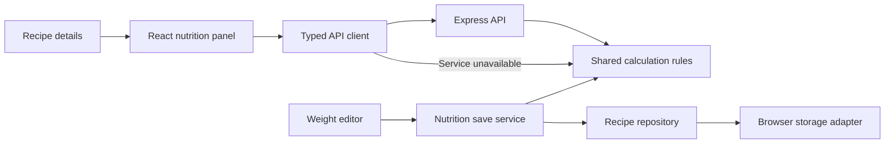

# Code and data

The frontend and API run as separate processes. Vite serves and builds the browser app. The nutrition estimate panel and cooking-history/daily-intake page are React/TypeScript components; other screens and the existing recipe/record dialogs still use JavaScript modules. This is an incremental migration, with compatible entry points for existing cooking, shopping and backup code.

```text
src/
  main.ts                       Vite entry point
  app.js                        Existing page rendering and interactions
  features/nutrition/
    NutritionPanel.tsx          React panel and ingredient/source components
    index.tsx                   Adapter between recipe dialogs and the React root
    reference-dialog.js         Existing weight editor during migration
  features/cooking/             React history, date filters and daily nutrition
  repositories/cooking.js       Cooking collection reads
  api/nutrition-client.ts       Typed HTTP client, cancellation and local fallback
  repositories/recipes.js       Validated recipe reads and writes
  services/nutrition.js         Fresh-read/save orchestration for manual references
  recipes.js, nutrition.js      Compatibility exports for existing callers
  storage.js                    Browser storage and atomic full-data replacement
  plans.js, pantry.js, ...       Existing menu, stock and cooking modules
shared/
  recipes.js                    Recipe/ingredient validation and pure filtering
  nutrition.js                  Matching, arithmetic and pure reference updates
  nutrition-data.js             Generated USDA snapshot and provenance
  nutrition-settings.js         Stored-reference validation and signatures
  daily-nutrition.ts            Actual-intake aggregation by date and meal
  nutrition-basis.js            Frozen per-serving estimates and validation
  dates.js                      Shared local/calendar date helpers
  contracts.ts                  Request, response and component data types
  nutrition-response.ts         Runtime response validation
  photo-validation.js           Shared photo metadata validation
server/
  app.ts                        Express routes, input limits and error responses
  index.ts                      Loopback listener and server configuration
public/mark.svg                 Shared header/favicon asset
tools/                         Dev launcher, syntax checks and USDA extraction
tests/                         Domain, storage, API and client tests
docs/images/                   Screenshots from the app
```

## Request flow



The nutrition client sends only the recipe yield, ingredient quantities/preparation, confirmed reference choices and requested servings. It excludes recipe IDs/titles, photos, steps and unrelated data. The API validates the versioned request, calculates a result and discards the input. It has no database, file-writing route or external AI connection. No request bodies are logged.

Response validation checks the dataset version, row identities, nullable values and coverage before the component uses a result. A new serving selection or unmounted dialog cancels the preceding request. Late results cannot replace the current view. Service failure uses the same calculation rules locally and shows a fallback message. Invalid local input is rejected rather than hidden by fallback.

Shared modules import only other shared modules. They do not import React, Express, browser globals, repositories or storage. The API never imports frontend modules. This boundary is checked in the test suite. API contracts are documented in [API.md](API.md).

## Running and building

`npm start` launches the API at `127.0.0.1:8020` and Vite at `127.0.0.1:8011`. Open **http://localhost:8011** to retain the existing browser origin. The frontend proxies `/api` to the backend; changing the browser URL to the API port does not open the app.

`npm run dev:frontend` and `npm run dev:server` run them independently. Optional `.env` settings are server configuration; Vite exposes no custom environment variables to browser code. Frontend output contains no server modules. No API key is needed for this milestone.

`npm run check` checks every JavaScript module and type-checks the migrated TypeScript. `npm test` runs domain/storage tests, real HTTP tests and API-client tests. `npm run build` creates the frontend in `dist/` with hashed assets, replacing the old manual import map. For a local production preview, run `npm run start:server` and `npm run preview` in separate terminals after stopping the development launcher.

## Local persistence

Recipes, photos/edit originals, plans, pantry batches, cooking records and shopping items remain in the current browser profile and origin. The API does not own or synchronize these collections. This refactor changes no storage keys or backup versions, and requires no data migration. Clearing site data still removes the local collections and recovery copy; downloaded JSON backups remain the way to keep a separate copy.

Each dish assignment references a recipe ID and stores its own date, meal and servings. Requirements use current recipe quantities. A missing recipe remains visible and raises a warning during ingredient checks. Nutrition references pin an ingredient index, ingredient signature, FDC ID, data version and total edible grams. Changed ingredients invalidate their old references. Backups and cooking snapshots preserve this metadata.

Existing single-dish menus load into the multiple-dish format without changing dates or servings. The first save preserves the original version-1 payload before writing version 2. Unreadable collections are reported rather than silently replaced.

Cooking records and pantry batches share the version-2 pantry payload. Stock deductions, undo and record changes use one localStorage write. Receipt markers prevent a retried purchase from adding groceries twice, even after a batch has been consumed. Failed writes preserve the preceding state.

After a full restore, the storage adapter writes all active collections and their recovery copy in one envelope, `eat-well-data-v1`. Ordinary writes retain other collections and recovery data. Older individual keys remain readable until the first restore succeeds.

## Cooking history and daily intake

The cooking adapter unmounts its React root before the legacy shell replaces page DOM. It keeps selected dates, tabs and filters across ordinary refreshes. Existing record, crop and stock dialogs still call the tested cooking operations. View changes do not write browser data.

Daily aggregation runs locally over validated cooking records and never consults current recipe-library entries. New records capture a compact per-serving nutrition basis in the same kitchen write as the record. The signature covers recipe yield, ingredient quantities/preparation and confirmed nutrition references. Subsequent portion/date/note edits and stock operations preserve it. Older records without the optional basis stay readable and use their saved recipe, with an explicit legacy-source note. Neither record reads nor daily summaries migrate or rewrite data.

Daily and meal subtotals preserve nulls, distinguish zero portions from unknown portions, and expose per-nutrient coverage. Only records on the selected calendar date are included. No extra API endpoint or personal intake upload is needed for these local summaries.
